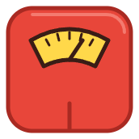
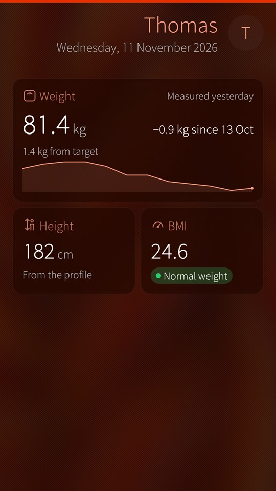
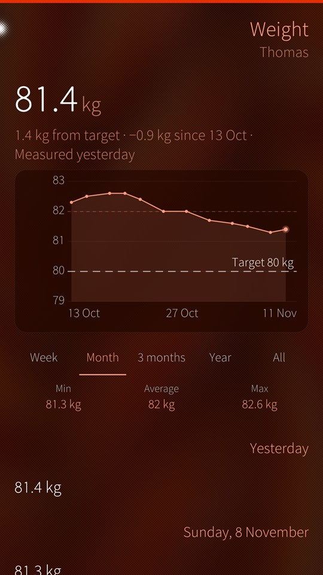
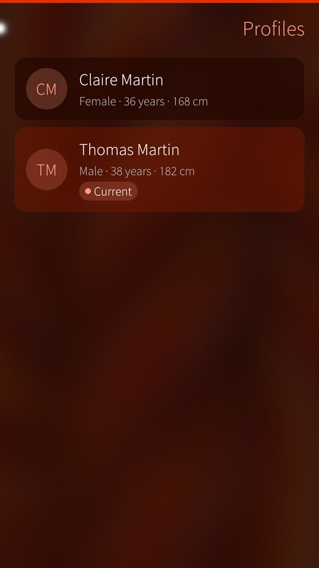
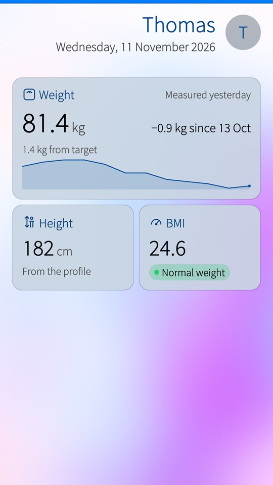
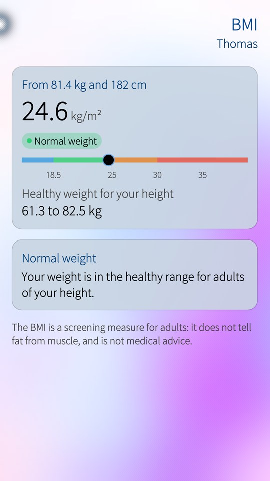
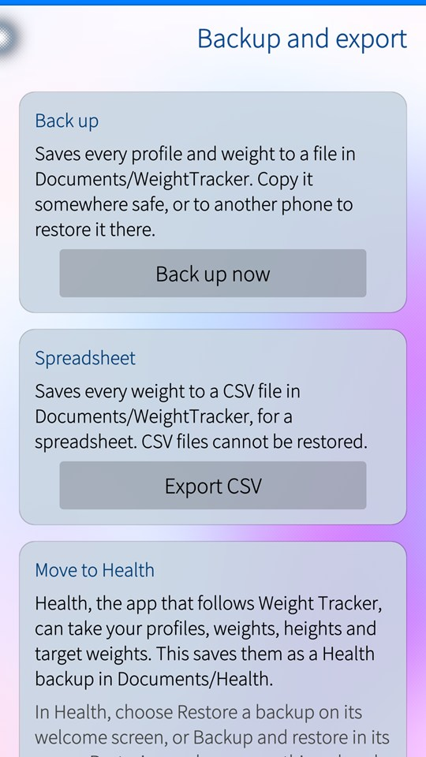

<p align="center">
  
</p>

<h1 align="center">Weight Tracker for Sailfish OS</h1>

<p align="center">
  <b>Your weight and your BMI, privately on your Sailfish OS phone.</b><br>
  For everyone in the family, with charts, a target weight and backups.<br>
  No account, no cloud. All locally on your phone.
</p>

<table>
  <tr>
    <td><a href="docs/images/dashboard.jpg"></a></td>
    <td><a href="docs/images/weight.jpg"></a></td>
    <td><a href="docs/images/profiles.jpg"></a></td>
  </tr>
  <tr>
    <td><a href="docs/images/dashboard-light.jpg"></a></td>
    <td><a href="docs/images/bmi-light.jpg"></a></td>
    <td><a href="docs/images/backup-light.jpg"></a></td>
  </tr>
</table>

## What you get

- **Your weight at a glance.** The latest weight, how it moved over the last month, the height and the BMI with its category.
- **Charts.** Every weight by week, month, 3 months, year or all of it, with the lowest, average and highest, and a line for your target weight.
- **Weights from any day.** Add a weight for an earlier day, edit or delete one.
- **The whole family.** A profile for everyone, switched in one tap.
- **Backups.** Save everything to a file in Documents/WeightTracker and restore it, also from Downloads or a memory card. A copy of the data is kept before every restore.
- **Spreadsheets.** Every weight in a CSV file.
- **Move to Health.** [Health](https://github.com/adelnoureddine/harbour-health) follows Weight Tracker: one tap saves your profiles, weights, heights and targets as a Health backup, which Health restores.
- **Cover support.** The latest weight, its trend and the BMI, and a new weight in one tap.

The BMI categories are those of the World Health Organization and the CDC for adults. Weight Tracker is not medical advice.

It follows your ambience, light or dark.

## Moving to Health

1. In Weight Tracker, pull down and choose **Backup and export**, then **Create Health backup**. The file is saved in Documents/Health.
2. In Health, choose **Restore a backup** on its welcome screen (or **Backup and restore** in its menu) and pick the file whose name starts with `weight-tracker-to-health`.

Restoring replaces everything already in Health, so do it before you start using Health. Health keeps a copy of what it had first.

## For developers

Build and validate with the Sailfish SDK (`sfdk tools list` shows your targets), or with the Sailfish IDE:

```
sfdk -c target=SailfishOS-5.1.0.11-aarch64 build
sfdk -c target=SailfishOS-5.1.0.11-aarch64 check
```

The package version comes from the latest git tag, so tag the release commit (for example `2.0`) before building it; the About page shows the same version. The build also refreshes the translation catalogues in `translations/`, where new languages are welcome.

The data folder is `~/.local/share/org.noureddine/WeighTracker`, misspelt since version 1.3: renaming it would leave existing users without their data.

## Authors

Weight Tracker started in 2021 as a course project at the Université de Pau et des Pays de l'Adour (France), by students under the supervision of Prof. Adel Noureddine.

Adel Noureddine (maintainer, © 2021-2026).

Manon Sauvageot, Yoann Dumont and Louis Puyou (initial authors, students, © 2021).

## License

Weight Tracker is licensed under the GNU GPL 3 license only (GPL-3.0-only).

Copyright (c) 2021-2026, Adel Noureddine, and contributors.
All rights reserved. This program and the accompanying materials are made available under the terms of the GNU General Public License v3.0 only (GPL-3.0-only) which accompanies this distribution, and is available at: https://www.gnu.org/licenses/gpl-3.0.en.html
